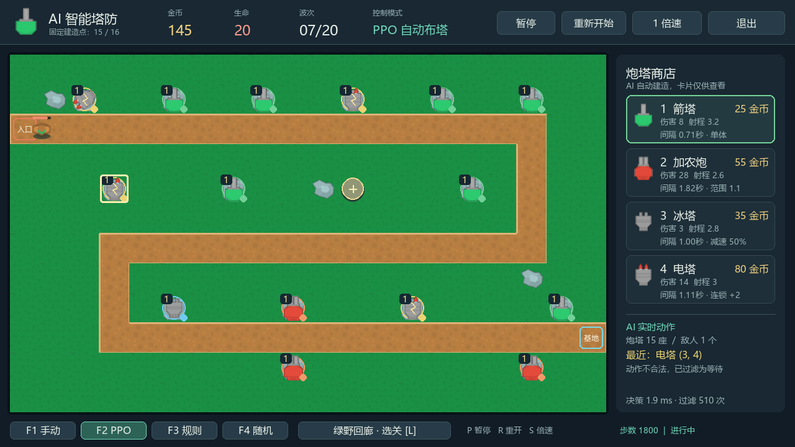

# AI 智能塔防

基于 Python、Pygame、Gymnasium 和 PyTorch 的 2D 塔防游戏，支持手动操作与 PPO 实时自动布塔。玩家可以在同一场战斗中切换控制方式，观察不同策略的建造选择。



## 功能

- 五张地图、固定建造点、四类炮塔和四类敌人。
- 中文 HUD、炮塔商店、关卡选择、攻击效果及结算统计。
- 手动建造、三级升级和出售；出售返还累计投入的 60%，向下取整。
- PPO、规则、随机三种自动布塔模式；支持暂停、重开与 1 / 4 倍速。
- 保留原始 Gymnasium 环境、训练和评估入口。

## 安装与运行

已验证环境为 Windows、Python 3.12。建议从仓库根目录执行以下命令，安装在本地虚拟环境中：

```powershell
py -3.12 -m venv .venv
.venv\Scripts\python.exe -m pip install --upgrade pip
.venv\Scripts\python.exe -m pip install -e ".[viewer,rl,dev]"
.venv\Scripts\python.exe -m ai_gym_td.scripts.play --agent manual --speed 1
```

运行 PPO 自动布塔：

```powershell
.venv\Scripts\python.exe -m ai_gym_td.scripts.play --agent ppo --ckpt agent.pt --level s_curve --seed 42 --speed 1
```

Windows 下也可以在安装完依赖后双击 `run_manual.cmd` 或 `run_ai.cmd`。后者默认以 4 倍速演示。普通游戏和 PPO 模型推理无需 API 密钥或云端服务。

Linux / macOS 可使用 `python3 -m venv .venv`、`.venv/bin/python` 执行相同模块命令；这些系统尚未进行实际图形界面验证。中文字体使用操作系统已安装字体，未打包系统字体；缺少 CJK 字体时可能无法正常显示中文。

## 操作

| 按键 / 操作 | 功能 |
| --- | --- |
| F1 / F2 / F3 / F4 | 手动 / PPO / 规则 / 随机 |
| 1–4 或点击商店 | 选择炮塔 |
| 点击圆形加号建造点 | 手动建塔 |
| 点击已有炮塔 | 查看属性，使用升级或出售按钮 |
| L | 选择关卡；切换后重新开始 |
| P / R / S | 暂停 / 重开 / 切换 1 与 4 倍速 |
| 空格 | 手动模式提前进入下一波 |
| Esc | 关闭关卡选择，或退出游戏 |

开始时有 120 金币和 20 生命，每关最多 20 波。建造需要同时满足金币、空位和固定建造点限制。建议先游玩绿野回廊，熟悉攻击范围与不同炮塔的配合。

## 地图与炮塔

| 地图 | 命令行标识 | 建造点 | 特点 |
| --- | --- | ---: | --- |
| 绿野回廊 | `s_curve` | 16 | 长路线，多次交火 |
| 双折山口 | `chokepoint` | 12 | 转角覆盖与入口防守 |
| 疾风防线 | `straight` | 12 | 短路线，集中火力 |
| 双环庭院 | `double_garden` | 10 | 双环覆盖与分区防守 |
| 峡谷接力 | `canyon_relay` | 9 | 多段防线，末段补漏 |

| 炮塔 | 初始价格 | 主要作用 |
| --- | ---: | --- |
| 箭塔 | 25 | 低成本单体攻击 |
| 加农炮 | 55 | 范围伤害 |
| 冰塔 | 35 | 减速控制 |
| 电塔 | 80 | 连锁攻击 |

敌人包括侦察兵、普通兵、重装兵与虫群，移动速度、生命和数量各不相同。具体参数以 `config.py`、`levels.py` 和 `upgrades.py` 为准。

## AI 与模型说明

`agent.pt` 是原始开源仓库提供的 PPO 预训练权重，本版本未重新训练模型。游戏通过适配层把环境观察传给策略，并将合法建造动作同步到 Pygame 界面。

- **PPO**：根据模型输出选择建造或等待；非法组合由适配层过滤为等待。
- **规则**：依据波次、金币、路径距离和局部敌人密度选择塔型与位置。
- **随机**：从可行动作中随机选择，用作对照。

现有自动策略只执行建造或等待，**不会自主升级或出售**。升级与出售由手动模式操作。预训练模型不保证在所有新地图上获胜。实时游戏使用固定建造点适配环境；原始 `evaluate` 入口使用原始环境，两者的结果不能直接当作同一实验。

## 测试与评估

```powershell
.venv\Scripts\python.exe -m pytest -q
.venv\Scripts\python.exe -m ai_gym_td.scripts.evaluate --agent ppo --ckpt agent.pt --episodes 1 --max-steps 12000 --seed 42
```

无显示器环境运行测试时可设置 `SDL_VIDEODRIVER=dummy`、`SDL_AUDIODRIVER=dummy`。实际发布检查见 [验证记录](docs/VALIDATION.md)。

## 结构

```text
ai_gym_td/        游戏、环境、策略与 Pygame 界面
  scripts/       运行、训练和评估入口
  assets/        游戏素材及来源清单
tests/           游戏逻辑与界面回归测试
examples/        环境调用示例
scripts/         可选基准测试和可视化工具
agent.pt         上游 PPO 预训练模型
docs/            游戏截图与验证说明
```

可选的 LLM 基准工具需另外安装 `.[llm]` 并自行配置环境变量；它不属于实时 Pygame 的四种模式。仓库不包含 API 密钥。

## 来源与许可

本项目基于 [AI Gym Tower Defense](https://github.com/DJLougen/ai-gym-tower-defense) 扩展，代码遵循 [MIT 许可证](LICENSE)。PPO 结构、训练入口和预训练权重来自该上游项目。图形界面、固定建造点、关卡与升级出售交互在此基础上扩展。

游戏贴图来自 Kenney Tower Defense (Top-Down)，采用 CC0-1.0；详细来源及原始许可证见 [ASSET_CREDITS.md](ASSET_CREDITS.md) 和 `ai_gym_td/assets/kenney/License.txt`。仓库未包含系统字体、展示视频或背景音乐。
